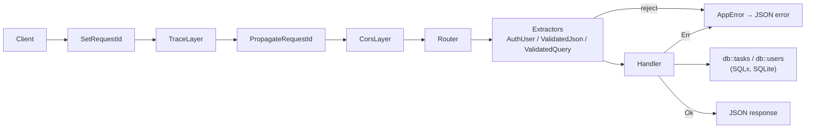

# TaskHub API

[中文](#中文) | [English](#english)

A production-style REST API for task / notes management, written in Rust with
**axum**, **SQLx (SQLite)**, **JWT** auth and **OpenAPI / Swagger UI** docs.

一个用 Rust 编写、贴近生产标准的任务/笔记管理 REST API：**axum** + **SQLx (SQLite)** + **JWT** 认证 + **OpenAPI / Swagger UI** 文档。

---

## 中文

### 简介

TaskHub API 是一个后端作品集项目，展示用 Rust 构建 Web 服务的常见工程实践：分层结构、认证鉴权、输入校验、统一错误处理、结构化日志、自动生成 API 文档、集成测试和容器化部署。

### 功能

- **用户**：注册、登录。密码使用 Argon2id（随机盐）哈希；登录返回带过期时间的 JWT（HS256）。
- **鉴权**：受保护接口需要 `Authorization: Bearer <token>`，通过 axum 提取器 `AuthUser` 实现。每个用户只能看到和修改自己的任务，访问他人任务一律返回 404。
- **任务 CRUD**：字段包括 `id`、`title`、`description`（可选）、`status`（`todo` / `in_progress` / `done`）、`due_date`（可选，RFC 3339 或 `YYYY-MM-DD`）、`tags`（字符串列表，单独建表存储）、`created_at`、`updated_at`。支持 `PATCH` 局部更新，`null` 可以清空可空字段。
- **列表查询**：
  - 分页：`page`、`per_page`（默认 20，最大 100）
  - 过滤：`status`、`tag`、`due_before` / `due_after`、`q`（在标题和描述中全文模糊搜索，转义 `%`/`_`）
  - 排序：`sort=created_at|due_date|title|status`，`order=asc|desc`（白名单枚举，不拼接用户输入，杜绝 SQL 注入）
  - 返回 `items` 加分页元数据 `page`、`per_page`、`total`、`total_pages`
- **输入校验**：`validator` crate。标题 1–200 字符且不能全为空白；用户名 3–32 位字母/数字/下划线；邮箱格式；密码 8–128 位且至少包含一个字母和一个数字。校验失败返回 422，并逐字段给出错误详情。
- **统一错误格式**：`{"error":{"code":"...","message":"...","details":...}}`，由单一的 `AppError`（实现 `IntoResponse`）生成，统一映射 400/401/403/404/409/422/500。500 错误不向客户端泄露内部信息，只写入服务端日志。
- **可观测性**：`tracing` + `tracing-subscriber`（`RUST_LOG` 控制级别）、tower-http `TraceLayer`、`x-request-id` 请求 ID（自动生成，或沿用客户端传入的值，并回写到响应头）、CORS。
- **API 文档**：utoipa 生成 OpenAPI 3.1，Swagger UI 位于 `/swagger-ui`，规范 JSON 位于 `/api-docs/openapi.json`，包含 Bearer 安全方案。
- **健康检查**：`GET /health` 返回服务状态和数据库连通性。
- **工程化**：迁移脚本嵌入二进制、启动时自动执行；环境变量配置（支持 `.env`）；Ctrl+C / SIGTERM 优雅停机；多阶段 Dockerfile（非 root 用户运行）。

### 架构

```text
src/
├── main.rs          # 精简入口：加载配置、初始化日志、连接数据库、执行迁移、启动服务、优雅停机
├── lib.rs           # build_app(state)：组装路由、Swagger UI 和中间件栈
├── config.rs        # 环境变量配置（Debug 输出时隐藏 JWT 密钥）
├── state.rs         # AppState：连接池、JWT 管理器、配置
├── error.rs         # AppError + 统一 JSON 错误响应
├── extract.rs       # ValidatedJson / ValidatedQuery / Path：把拒绝原因统一转换成 AppError
├── openapi.rs       # utoipa OpenAPI 文档 + bearer_auth 安全方案
├── auth/            # password.rs (Argon2id)、jwt.rs (签发/校验)、extractor.rs (AuthUser)
├── db/              # 连接池与迁移；users.rs / tasks.rs 数据访问层（所有任务查询都按 user_id 限定）
├── models/          # 请求/响应 DTO、数据库行类型、校验规则、日期解析
└── routes/          # health.rs、auth.rs、tasks.rs：精简的处理函数
migrations/          # SQL 迁移（sqlx::migrate! 编译期嵌入）
tests/               # 集成测试（内存 SQLite + tower::ServiceExt::oneshot，不走网络）
```

请求流程：



### 安装与运行

需要 Rust stable 工具链（SQLite 由 `libsqlite3-sys` 内置编译，需要 C 编译器）。

```bash
cp .env.example .env        # 然后把 JWT_SECRET 改成一个足够长的随机值
cargo run                   # 默认监听 http://127.0.0.1:3000
```

打开 `http://localhost:3000/swagger-ui/` 即可在浏览器里调试接口。

> Debug 构建如果没有设置 `JWT_SECRET`，会使用一个仅供开发的默认密钥，并在日志中打印醒目警告；Release 构建缺少 `JWT_SECRET` 时直接拒绝启动。

#### Docker

```bash
docker build -t taskhub-api .
docker run --rm -p 3000:3000 \
  -e JWT_SECRET="$(openssl rand -base64 48)" \
  -v taskhub-data:/app/data \
  taskhub-api
```

镜像为多阶段构建（`rust:1-slim-bookworm` 编译 → `debian:bookworm-slim` 运行），以非 root 用户 `taskhub` 运行，数据库默认在卷目录 `/app/data/taskhub.db`。

> **已验证（2026-11-11）：** 在 WSL（Debian）中使用 Docker Engine 29.9.3 成功构建镜像（`taskhub-api:local`，约 148 MB），容器以非 root 用户 `taskhub`（uid 10001）运行，SQLite 数据库存放在挂载到 `/app/data` 的卷中。实际用 curl 验证通过：`GET /health`（200）、注册（201）、登录（200）、`GET /auth/me`（200）、创建任务（201）、按标签筛选列表（200）、获取任务（200）、`PATCH`（200）、`DELETE`（204）、删除后再获取（404）、`/swagger-ui/`（200）。

### 配置

| 变量 | 默认值 | 说明 |
|---|---|---|
| `DATABASE_URL` | `sqlite://taskhub.db` | SQLx 连接串，文件不存在时自动创建；`sqlite::memory:` 为内存库 |
| `HOST` | `127.0.0.1` | 监听 IP（Docker 镜像中为 `0.0.0.0`） |
| `PORT` | `3000` | 监听端口 |
| `BIND_ADDR` | – | 例如 `0.0.0.0:8080`，设置后覆盖 `HOST`/`PORT` |
| `JWT_SECRET` | –（Release 必填） | HS256 签名密钥，建议 ≥ 32 字节随机值 |
| `JWT_EXPIRY_SECONDS` | `3600` | 访问令牌有效期（秒） |
| `CORS_ALLOWED_ORIGINS` | `*` | 逗号分隔的允许来源；为空或 `*` 表示允许任意来源 |
| `RUST_LOG` | `taskhub_api=info,tower_http=info` | 日志过滤（EnvFilter 语法） |

### API 接口

| 方法 | 路径 | 鉴权 | 说明 |
|---|---|---|---|
| GET | `/health` | 否 | 服务状态 + 数据库检查 |
| POST | `/api/v1/auth/register` | 否 | 注册（201；用户名/邮箱重复 409） |
| POST | `/api/v1/auth/login` | 否 | 登录，返回 JWT |
| GET | `/api/v1/auth/me` | Bearer | 当前用户信息 |
| POST | `/api/v1/tasks` | Bearer | 创建任务（201） |
| GET | `/api/v1/tasks` | Bearer | 任务列表（分页/过滤/排序） |
| GET | `/api/v1/tasks/{id}` | Bearer | 获取单个任务 |
| PATCH | `/api/v1/tasks/{id}` | Bearer | 局部更新 |
| DELETE | `/api/v1/tasks/{id}` | Bearer | 删除（204） |
| GET | `/swagger-ui/` | 否 | Swagger UI |
| GET | `/api-docs/openapi.json` | 否 | OpenAPI 规范 |

列表查询参数：`page`、`per_page`（1–100）、`status`、`tag`、`due_before`、`due_after`（RFC 3339 或 `YYYY-MM-DD`，包含边界）、`q`、`sort`（`created_at` | `due_date` | `title` | `status`，默认 `created_at`）、`order`（`asc` | `desc`，默认 `desc`）。按 `due_date` 排序时没有截止日期的任务总排在最后；按 `status` 排序时按流程顺序 `todo → in_progress → done`。

### curl 示例

完整的真实请求与响应见下方英文部分的 [curl examples](#curl-examples)，输出均来自实际运行本项目代码时的记录。

### 测试

```bash
cargo test                                   # 32 个测试：4 个单元测试 + 28 个集成测试
cargo fmt --check
cargo clippy --all-targets -- -D warnings
```

集成测试为每个用例创建独立的内存 SQLite 数据库，通过 `tower::ServiceExt::oneshot` 直接调用路由，不占用网络端口。覆盖范围：健康检查、注册、重复注册（409）、登录成功/失败、未带令牌和篡改令牌（401）、任务 CRUD、用户间数据隔离、校验错误（422）、分页/过滤/排序、排序字段白名单、请求 ID、CORS 预检、OpenAPI 和 Swagger UI。

### 许可证

MIT © 2026 JinJU，见 [LICENSE](LICENSE)。

---

## English

### Overview

TaskHub API is a backend portfolio project showing how I build web services
in Rust: a layered structure, authentication and authorization, input
validation, a single error type, structured logging, generated API docs,
integration tests and a container image.

### Features

- **Users**: register and log in. Passwords are hashed with Argon2id using a random salt. Login returns an HS256 JWT that expires.
- **Authorization**: protected routes require `Authorization: Bearer <token>`, enforced by the `AuthUser` axum extractor. Users can only see and change their own tasks. Requests for another user's task return 404.
- **Task CRUD**: `id`, `title`, `description` (optional), `status` (`todo` / `in_progress` / `done`), `due_date` (optional, RFC 3339 or `YYYY-MM-DD`), `tags` (list of strings, stored in a separate table), `created_at` and `updated_at`. `PATCH` updates only the fields you send. Sending `null` clears a nullable field.
- **Listing**:
  - pagination: `page`, `per_page` (default 20, max 100)
  - filters: `status`, `tag`, `due_before` / `due_after`, `q` (case-insensitive search in title and description; `%` and `_` are matched literally)
  - sorting: `sort=created_at|due_date|title|status`, `order=asc|desc`. Both values are parsed into closed enums, so user input is never interpolated into SQL.
  - the response contains `items` plus `page`, `per_page`, `total` and `total_pages`
- **Validation** with the `validator` crate: the title must be 1–200 characters and not just whitespace; the username must be 3–32 letters, digits or underscores; the email must be valid; the password must be 8–128 characters with at least one letter and one digit. Failures return 422 with details for each field.
- **One error format**: `{"error":{"code":"...","message":"...","details":...}}`, produced by a single `AppError` type that implements `IntoResponse`. It maps errors to 400/401/403/404/409/422/500 the same way everywhere. 500 responses never include internal error text, which is only logged on the server.
- **Observability**: `tracing` and `tracing-subscriber` (configured with `RUST_LOG`), the tower-http `TraceLayer`, and an `x-request-id` header. The server generates the ID, or keeps the one the client sent, and echoes it in the response. CORS is enabled.
- **API docs**: utoipa generates an OpenAPI 3.1 spec, with a bearer security scheme. Swagger UI is at `/swagger-ui` and the spec at `/api-docs/openapi.json`.
- **Health check**: `GET /health` reports service status and whether the database is reachable.
- **Operations**: migrations are embedded in the binary and run at startup. Configuration comes from environment variables (`.env` is supported). Ctrl+C and SIGTERM trigger a graceful shutdown. The multi-stage Dockerfile runs the server as a non-root user.

### Architecture

```text
src/
├── main.rs          # thin entry point: config, logging, DB pool, migrations, serve, graceful shutdown
├── lib.rs           # build_app(state): routes + Swagger UI + middleware stack
├── config.rs        # env-based configuration (JWT secret redacted in Debug output)
├── state.rs         # AppState: pool, JWT manager, config
├── error.rs         # AppError + unified JSON error response
├── extract.rs       # ValidatedJson / ValidatedQuery / Path: turn rejections into AppError
├── openapi.rs       # utoipa OpenAPI document + bearer_auth security scheme
├── auth/            # password.rs (Argon2id), jwt.rs (issue/verify), extractor.rs (AuthUser)
├── db/              # pool + migrations; users.rs / tasks.rs repositories (every task query scoped by user_id)
├── models/          # request/response DTOs, row types, validation rules, date parsing
└── routes/          # health.rs, auth.rs, tasks.rs: thin handlers
migrations/          # SQL migrations (embedded at compile time via sqlx::migrate!)
tests/               # integration tests (in-memory SQLite + tower::ServiceExt::oneshot, no network)
```

Request flow:


Queries are checked at runtime (`sqlx::query` / `query_as` with `FromRow`) instead of with the compile-time `query!` macros, so building never needs `DATABASE_URL` or offline query data.

### Install & run

Requires a stable Rust toolchain. SQLite is compiled in by `libsqlite3-sys`, so a C compiler is also needed.

```bash
cp .env.example .env        # then set JWT_SECRET to a long random value
cargo run                   # listens on http://127.0.0.1:3000 by default
```

To try the API in a browser, open `http://localhost:3000/swagger-ui/`.

> If `JWT_SECRET` is unset, debug builds fall back to a dev-only key and log a loud warning. Release builds refuse to start without it.

#### Docker

```bash
docker build -t taskhub-api .
docker run --rm -p 3000:3000 \
  -e JWT_SECRET="$(openssl rand -base64 48)" \
  -v taskhub-data:/app/data \
  taskhub-api
```

The image is a multi-stage build: it compiles in `rust:1-slim-bookworm` and runs in `debian:bookworm-slim`. The server runs as the non-root user `taskhub`, and the database defaults to `/app/data/taskhub.db` on a volume.

> **Verified (2026-11-11):** the image was built with Docker Engine 29.9.3 in WSL (Debian) (`taskhub-api:local`, about 148 MB). The container runs as the non-root user `taskhub` (uid 10001) and keeps the SQLite database in a volume mounted at `/app/data`. These real curl calls passed: `GET /health` (200), register (201), login (200), `GET /auth/me` (200), create task (201), list filtered by tag (200), get task (200), `PATCH` (200), `DELETE` (204), get after delete (404), and `/swagger-ui/` (200).

### Configuration

| Variable | Default | Description |
|---|---|---|
| `DATABASE_URL` | `sqlite://taskhub.db` | SQLx connection string; the file is created if missing. `sqlite::memory:` for in-memory |
| `HOST` | `127.0.0.1` | Bind IP (`0.0.0.0` in the Docker image) |
| `PORT` | `3000` | Bind port |
| `BIND_ADDR` | – | e.g. `0.0.0.0:8080`; overrides `HOST`/`PORT` |
| `JWT_SECRET` | – (required for release builds) | HS256 signing secret; use ≥ 32 random bytes |
| `JWT_EXPIRY_SECONDS` | `3600` | Access-token lifetime in seconds |
| `CORS_ALLOWED_ORIGINS` | `*` | Comma-separated allowed origins; empty or `*` = any |
| `RUST_LOG` | `taskhub_api=info,tower_http=info` | Log filter (EnvFilter syntax) |

### API endpoints

| Method | Path | Auth | Description |
|---|---|---|---|
| GET | `/health` | no | Service status + DB check |
| POST | `/api/v1/auth/register` | no | Register (201; 409 on duplicate username/email) |
| POST | `/api/v1/auth/login` | no | Log in, returns a JWT |
| GET | `/api/v1/auth/me` | Bearer | Current user profile |
| POST | `/api/v1/tasks` | Bearer | Create a task (201) |
| GET | `/api/v1/tasks` | Bearer | List tasks (pagination / filters / sorting) |
| GET | `/api/v1/tasks/{id}` | Bearer | Get one task |
| PATCH | `/api/v1/tasks/{id}` | Bearer | Partial update |
| DELETE | `/api/v1/tasks/{id}` | Bearer | Delete (204) |
| GET | `/swagger-ui/` | no | Swagger UI |
| GET | `/api-docs/openapi.json` | no | OpenAPI spec |

List query parameters:

- `page`, `per_page` (1–100)
- `status`, `tag`, `q`
- `due_before`, `due_after`: RFC 3339 or `YYYY-MM-DD`; both bounds are inclusive
- `sort`: `created_at` | `due_date` | `title` | `status`, default `created_at`
- `order`: `asc` | `desc`, default `desc`

When sorting by `due_date`, tasks without a due date always come last. Sorting by `status` follows the workflow order `todo → in_progress → done`.

### curl examples

These are real requests and responses captured from a run of this code. For readability, the host was normalised to `localhost:3000` and the JWT was truncated to `...`. In the commands, `$TOKEN` holds the `access_token` returned by login. Two more tasks were created between the steps below (one of them is task 2 in the list output). Those requests are not shown.

Health check:

```bash
$ curl -s http://localhost:3000/health
{"status":"ok","database":"ok","version":"0.1.0"}
```

Register, then register the same user again (409):

```bash
$ curl -s -X POST http://localhost:3000/api/v1/auth/register -H 'Content-Type: application/json' -d '{"username":"alice","email":"alice@example.com","password":"correct-horse-42"}'
{"id":1,"username":"alice","email":"alice@example.com","created_at":"2026-11-11T09:11:17.908Z"}
```

```bash
$ curl -s -X POST http://localhost:3000/api/v1/auth/register -H 'Content-Type: application/json' -d '{"username":"alice","email":"alice@example.com","password":"correct-horse-42"}'
{"error":{"code":"conflict","message":"A user with this email already exists","details":{"field":"email"}}}
```

Log in and fetch the current user:

```bash
$ curl -s -X POST http://localhost:3000/api/v1/auth/login -H 'Content-Type: application/json' -d '{"username":"alice","password":"correct-horse-42"}'
{"access_token":"eyJ0eXAiOiJ...","token_type":"Bearer","expires_in":3600}
```

```bash
$ curl -s http://localhost:3000/api/v1/auth/me -H "Authorization: Bearer $TOKEN"
{"id":1,"username":"alice","email":"alice@example.com","created_at":"2026-11-11T09:11:17.908Z"}
```

Create a task:

```bash
$ curl -s -X POST http://localhost:3000/api/v1/tasks -H "Authorization: Bearer $TOKEN" -H 'Content-Type: application/json' -d '{"title":"Write API docs","description":"OpenAPI + README","status":"in_progress","due_date":"2026-11-20T18:00:00Z","tags":["docs","backend"]}'
{"id":1,"title":"Write API docs","description":"OpenAPI + README","status":"in_progress","due_date":"2026-11-20T18:00:00Z","tags":["backend","docs"],"created_at":"2026-11-11T09:11:18.039Z","updated_at":"2026-11-11T09:11:18.039Z"}
```

List with a filter, sorting and pagination:

```bash
$ curl -s "http://localhost:3000/api/v1/tasks?tag=backend&sort=due_date&order=asc&page=1&per_page=10" -H "Authorization: Bearer $TOKEN"
{"items":[{"id":1,"title":"Write API docs","description":"OpenAPI + README","status":"in_progress","due_date":"2026-11-20T18:00:00Z","tags":["backend","docs"],"created_at":"2026-11-11T09:11:18.039Z","updated_at":"2026-11-11T09:11:18.039Z"},{"id":2,"title":"Add rate limiting","description":null,"status":"todo","due_date":"2026-11-30T12:00:00Z","tags":["backend"],"created_at":"2026-11-11T09:11:18.049Z","updated_at":"2026-11-11T09:11:18.049Z"}],"pagination":{"page":1,"per_page":10,"total":2,"total_pages":1}}
```

Partial update:

```bash
$ curl -s -X PATCH http://localhost:3000/api/v1/tasks/1 -H "Authorization: Bearer $TOKEN" -H 'Content-Type: application/json' -d '{"status":"done"}'
{"id":1,"title":"Write API docs","description":"OpenAPI + README","status":"done","due_date":"2026-11-20T18:00:00Z","tags":["backend","docs"],"created_at":"2026-11-11T09:11:18.039Z","updated_at":"2026-11-11T09:11:18.076Z"}
```

Validation error (422) and missing token (401):

```bash
$ curl -s -X POST http://localhost:3000/api/v1/tasks -H "Authorization: Bearer $TOKEN" -H 'Content-Type: application/json' -d '{"title":""}'
{"error":{"code":"validation_error","message":"Request validation failed","details":{"title":[{"code":"length","message":"must be between 1 and 200 characters"},{"code":"blank","message":"must not be blank"}]}}}
```

```bash
$ curl -s http://localhost:3000/api/v1/tasks
{"error":{"code":"unauthorized","message":"Missing Authorization header"}}
```

Delete (204, with request id and CORS headers), then fetch it again (404):

```bash
$ curl -s -i -X DELETE http://localhost:3000/api/v1/tasks/3 -H "Authorization: Bearer $TOKEN"
HTTP/1.1 204 No Content
vary: origin, access-control-request-method, access-control-request-headers
access-control-allow-origin: *
access-control-expose-headers: x-request-id
x-request-id: 8328aa42-7e75-4437-a4d7-28ec1eac69f3
date: Wed, 11 Nov 2026 09:11:18 GMT
```

```bash
$ curl -s http://localhost:3000/api/v1/tasks/3 -H "Authorization: Bearer $TOKEN"
{"error":{"code":"not_found","message":"Task not found"}}
```

API docs:

```bash
$ curl -s -o /dev/null -w '%{http_code}\n' http://localhost:3000/swagger-ui/
200
```

```bash
$ curl -s http://localhost:3000/api-docs/openapi.json | head -c 200
{"openapi":"3.1.0","info":{"title":"TaskHub API","description":"Task / notes management REST API with JWT authentication.","license":{"name":"MIT"},"version":"0.1.0"},"paths":{"/api/v1/auth/login":{"p
```

### Testing

```bash
cargo test                                   # 32 tests: 4 unit + 28 integration
cargo fmt --check
cargo clippy --all-targets -- -D warnings
```

Each integration test gets its own in-memory SQLite database and calls the router directly through `tower::ServiceExt::oneshot`, so no network port is used. The tests cover:

- health check and registration, including duplicate registration (409)
- login success and failure, and missing or tampered tokens (401)
- task CRUD and isolation between users
- validation errors (422)
- pagination, filtering and sorting, including the sort-column whitelist
- request IDs, CORS preflight, the OpenAPI spec and Swagger UI

### Tech stack

axum 0.8 · tokio 1 · SQLx 0.9 (SQLite) · argon2 0.6 · jsonwebtoken 11 · validator 0.21 · tower-http 0.6 · tracing · utoipa 6 + utoipa-swagger-ui 10 · dotenvy · chrono

### License

MIT © 2026 JinJU. See [LICENSE](LICENSE).
